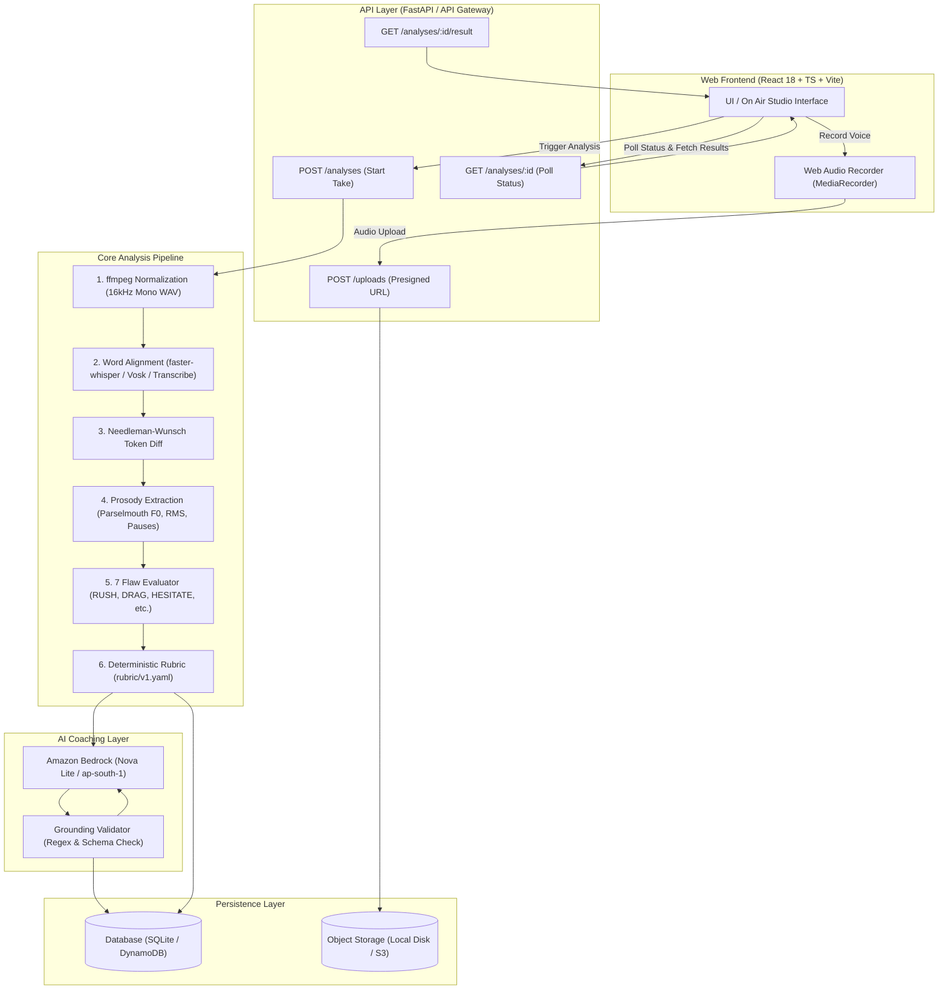

# SpeakQuest — Master Project Documentation

**A deterministic speech-coaching platform with kinetic variable typography and grounded AI instruction.**

---

## 1. Executive Summary

SpeakQuest is an end-to-end speech coaching and evaluation platform designed for broadcasters, public speakers, presenters, and language learners. 

Unlike traditional LLM wrappers that guess how someone sounds from audio or raw text transcripts, SpeakQuest:
1. **Extracts acoustic measurements** directly from the audio using digital signal processing (DSP) and Praat acoustic algorithms.
2. **Evaluates performance deterministically** against a calibrated reference reading using a versioned rubric ([`rubric/v1.yaml`](../rubric/v1.yaml)).
3. **Visualizes prosody kinetically** using variable OpenType fonts where word width, weight, baseline shift, and physical spacing reflect real-time speaking rate, loudness, pitch, and pauses.
4. **Delivers strictly grounded AI coaching** using Amazon Bedrock, bounded by a validation layer that automatically rejects hallucinated numbers or fake timestamps.

---

## 2. Architecture & System Design

SpeakQuest implements a **dual-runtime architecture**: a lightweight local runtime (`speakquest-local`) for development and self-hosting, and an enterprise AWS serverless runtime provisioned with Terraform.



### Dual-Runtime Breakdown

| Feature | Local Runtime (`speakquest-local`) | AWS Cloud Runtime |
|---|---|---|
| **API Host** | Python `ThreadingHTTPServer` (`:8787`) | Amazon API Gateway v2 HTTP API |
| **Orchestration** | Python In-Memory Thread Pool Workflow | AWS Step Functions State Machine |
| **Word Alignment** | `faster-whisper` (`base.en`) or `Vosk` | Amazon Transcribe (`en-US`) |
| **Acoustics & Scoring** | Native Python (`scipy`, `numpy`, `parselmouth`) | Containerized Lambda Worker Image |
| **Coaching LLM** | Amazon Bedrock Converse (`apac.amazon.nova-lite-v1:0`) | Amazon Bedrock Converse |
| **Database** | SQLite single-file (`.local/speakquest.sqlite`) | Amazon DynamoDB Single-Table Design |
| **Object Storage** | Local Disk with HMAC-SHA256 signature tokens | Amazon S3 Presigned URLs |

---

## 3. The Core Analysis Pipeline

The analysis pipeline is a pure function:
$$\text{AnalysisResult} = f(\text{Audio}, \text{Transcript}, \text{Script}, \text{Reference}, \text{Rubric})$$

```
services/worker/speakquest/
├── normalize.py      # Audio validation & ffmpeg normalization
├── timing.py         # Speech-to-text word timing adapters
├── tokens.py         # Text canonicalization & phonetic phrase splitting
├── diff.py           # Needleman-Wunsch script alignment
├── features.py       # DSP & Praat acoustic feature extraction
├── findings.py       # 7 Flaw detection rules
├── rubric.py         # Deterministic rubric penalty engine
└── pipeline.py       # Pipeline orchestration
```

### 1. Audio Normalization (`normalize.py`)
* Converts incoming audio (WebM, Ogg, MP3, WAV, M4A) to standard **16 kHz, 16-bit Mono PCM WAV**.
* Runs sanity validations: minimum duration ($\ge 1.0\text{ s}$), maximum duration ($\le 120\text{ s}$), silent take detection ($< -50\text{ dBFS}$), and clipping detection.

### 2. Speech Timing & Alignment (`timing.py`)
* Extracts word-level boundary timestamps $(t_{\text{start}}, t_{\text{end}})$ and confidence scores for every spoken word.
* Powered locally by `faster-whisper` with automatic model caching in `.models/`.

### 3. Token Normalization & Script Diff (`tokens.py`, `diff.py`)
* Canonicalizes punctuation, lowercases words, and expands numbers, percentages, years, and currencies into phonetically spoken words (e.g. `$30` $\to$ `"thirty dollars"`).
* Runs global **Needleman–Wunsch alignment** comparing spoken words with the target script tokens, classifying each operation into:
  * `match`: Exact word match.
  * `sub`: Substituted word.
  * `ins`: Extra word (classified as `filler`, `repeat`, or generic `insert`).
  * `del`: Skipped script word.

### 4. Acoustic Prosody Feature Extraction (`features.py`)
* **Pitch (Fundamental Frequency $F_0$):** Extracted via **Praat Parselmouth** (autocorrelation algorithm). Pitch is normalized per speaker and measured in **semitones relative to the speaker's median** $F_0$:
  $$\Delta \text{st} = 12 \times \log_2\left(\frac{F_0}{\text{median}(F_0)}\right)$$
* **Loudness:** Measured via root-mean-square (RMS) energy per word in decibels relative to the speaker's mean take volume ($\text{dBFS}$).
* **Pauses:** Measured by thresholding silence energy envelopes between words (in milliseconds).
* **Speaking Rate:** Local speech rate ratio calculated by comparing spoken syllable duration to the reference reading's duration across identical script words.

---

## 4. The 7 Flaw Rules & Deterministic Scoring

Scores are **never estimated by an LLM**. They are calculated mathematically via the versioned rubric ([`rubric/v1.yaml`](../rubric/v1.yaml)):

$$\text{Dimension Score} = \max\left(0, 100 - \sum \text{Penalties}\right)$$

| Flaw Code | Dimension | Description | Trigger Threshold | Severity Penalties |
|---|---|---|---|---|
| **`RUSH`** | Pace | Delivered significantly faster than reference | Rate ratio $> 1.30\times$ reference | Minor: 3, Moderate: 6, Severe: 10 |
| **`DRAG`** | Pace | Delivered significantly slower than reference | Rate ratio $< 0.75\times$ reference | Minor: 3, Moderate: 6, Severe: 10 |
| **`HESITATE`** | Pauses | Unnatural hesitation or pause | Gap $\ge 450\text{ ms}$ ($\ge 2.5\times$ reference pause) | Minor: 3, Moderate: 6, Severe: 10 |
| **`MONO`** | Pitch | Robotic, flat delivery lacking expression | Pitch standard deviation $< 1.40\text{ semitones}$ | Minor: 4, Moderate: 8, Severe: 12 |
| **`FADE`** | Volume | Voice trailing off at the end of a phrase | Drop $> 6.5\text{ dB}$ below speaker take mean | Minor: 3, Moderate: 6, Severe: 9 |
| **`SKIP`** | Accuracy | Missing or skipped script words | Script token not spoken | Minor: 4, Moderate: 8, Severe: 12 |
| **`FILLER`** | Accuracy | Extra words, vocalized pauses (`um`, `uh`) | Insertion or vocalized hesitation | Minor: 2, Moderate: 5, Severe: 8 |

---

## 5. Grounded Bedrock AI Coaching

Coaching notes are authored by Amazon Bedrock using **Amazon Nova Lite** (`apac.amazon.nova-lite-v1:0` in `ap-south-1` or `us.amazon.nova-2-lite-v1:0` in `us-east-1`).

### The Grounding Validator (`validator.py`)
To prevent LLM hallucination, every output is passed through an automated grounding validator:
1. **No Invented Numbers:** The LLM may only output numbers that exist verbatim in the measured flaw evidence or quoted from the script.
2. **No Invented Timestamps:** Banned from stating timestamps (e.g. *"at 3.4 seconds"*). The interface visually renders where flaws occur.
3. **Structured Response:** Must return strict JSON with `finding_id`, `headline`, `why`, and a concrete, actionable `drill`.
4. **Retry Loop:** If the LLM generates a hallucination, the validator sends a corrective prompt. If it fails a second time, it safely falls back to a deterministic, pre-authored coaching template.

---

## 6. Frontend: The "On Air" Design System

The frontend is built with **React 18 + TypeScript + Vite + Tailwind CSS** with a retro broadcast studio aesthetic.

```
web/
├── src/
│   ├── api/          # HTTP adapter & schema types (Zod)
│   ├── components/   # Waveform, Transcript, Audio Meter, Controls
│   ├── pages/        # CuePage, TakePage, MePage
│   ├── lib/          # Levels, stamps, theme state
│   └── styles/       # Typography, hatched patterns, booth/paper themes
```

### The Kinetic Transcript ("The Transcript is the Chart")
Instead of reading separate charts, the spoken words themselves visualize delivery:
* **Font Stretch (`wdth`):** Words stretch wide when dragging, condense narrow when rushed.
* **Font Weight (`wght`):** Words become bold when loud, light/thin when quiet or fading.
* **Vertical Baseline:** Words shift upwards or downwards to show pitch contour.
* **Literal Pause Spacing:** The visual gap between words on screen is proportional to the millisecond silence duration.
* **Flaw Underlines:** Flaws receive hatched underline patterns and indicator badges.

### Audio Waveform
* Rendered via **WaveSurfer.js v7** with real microphone audio.
* Flaw time intervals are rendered as color-coded interactive regions that scrub the audio when clicked.

---

## 7. Data Contracts & Schema Synchronization

Data contracts are defined in Python using **Pydantic v2** (`services/worker/speakquest/contracts.py`).
* Run `make contracts` to export the contracts as standard JSON Schema into `contracts/schema.json`.
* The web frontend's **Zod** validators (`web/src/api/schema.ts`) are synchronized against this schema, preventing API drift between frontend and backend.

### Key API Endpoints

| Method | Endpoint | Description |
|---|---|---|
| `GET` | `/challenges` | Lists all 8 studio script challenges |
| `POST` | `/uploads` | Generates signed audio upload URL with size & type locks |
| `POST` | `/analyses` | Enqueues a recorded take for processing |
| `GET` | `/analyses/{id}` | Returns take status (`QUEUED`, `RUNNING`, `DONE`, `FAILED`) |
| `GET` | `/analyses/{id}/result` | Returns full analysis, measurements, kinetic tokens, and Bedrock coaching |
| `GET` | `/me/progress` | Returns session air time, speaker level, and unlocked stamps |

---

## 8. Setup & Operations Guide

### Prerequisites
* **Python:** $\ge 3.12$ (managed automatically by `uv`)
* **Node.js:** $\ge 20$ / `npm`
* **FFmpeg:** Installed and on system PATH
* **AWS Credentials:** IAM User with Amazon Bedrock permissions in `ap-south-1` or `us-east-1`.

### 1. Environment Configuration (`.env`)
```ini
AWS_ACCESS_KEY_ID=your_access_key
AWS_SECRET_ACCESS_KEY=your_secret_key
AWS_REGION=ap-south-1

SPEAKQUEST_LOCAL_DIR=.local
SPEAKQUEST_LOCAL_BASE_URL=http://localhost:8787
SPEAKQUEST_LOCAL_ALIGNER=faster-whisper
SPEAKQUEST_ALLOWED_ORIGINS=http://localhost:5173
SPEAKQUEST_MODEL_DIR=.models
SPEAKQUEST_WHISPER_MODEL=base.en
SPEAKQUEST_BEDROCK=1
SPEAKQUEST_BEDROCK_MODEL_ID=apac.amazon.nova-lite-v1:0
```

### 2. Frontend Configuration (`web/.env`)
```ini
VITE_API_URL=http://localhost:8787
VITE_DEMO=0
```

### 3. Running the System
```bash
# Terminal 1: Start backend API + workflow engine
uv run python -m speakquest_api.local.server serve --port 8787

# Terminal 2: Start web frontend
npm --prefix web run dev
```
Open **http://localhost:5173/** in your browser.

---

## 9. Verification & Quality Assurance

| Test Suite | Command | Coverage |
|---|---|---|
| **Live Bedrock AI** | `uv run pytest tests/test_explain.py -k live_bedrock` | Live Converse call in `ap-south-1` + Grounding Validator |
| **Speech Alignment** | `uv run python -c "from speakquest.timing import get_aligner..."` | `faster-whisper` word timing and boundaries |
| **Pipeline Rules** | `uv run pytest tests/test_pipeline_rules.py` | 7 flaw rules and severity thresholds |
| **API Handlers** | `uv run pytest tests/test_api_handlers.py` | HTTP envelopes, status polling, and error codes |
| **Frontend Build** | `npm --prefix web run build` | TypeScript compile (`tsc`) + Vite production bundle |

---

## 10. Repository Structure

```text
SpeakQuest/
├── contracts/               # JSON Schema derived from Pydantic models
├── data/
│   ├── audio/              # Reference WAV audio for challenges
│   ├── annotations/        # Benchmark flaw annotations
│   └── scripts/            # Script YAMLs and prompts
├── docs/                   # System design, architecture, operations & report
├── eval/                   # Benchmark evaluation harness
├── infra/                  # Terraform modules for AWS cloud deployment
├── rubric/
│   └── v1.yaml             # Versioned scoring rubric & thresholds
├── scripts/                # Utility scripts (seed, build, verify-zero)
├── services/
│   ├── api/                # HTTP API handlers & local SQLite runner
│   ├── explain/            # Bedrock AI coaching & grounding validator
│   └── worker/             # DSP, speech alignment & flaw analysis
└── web/                    # React 18 + Vite frontend
```
